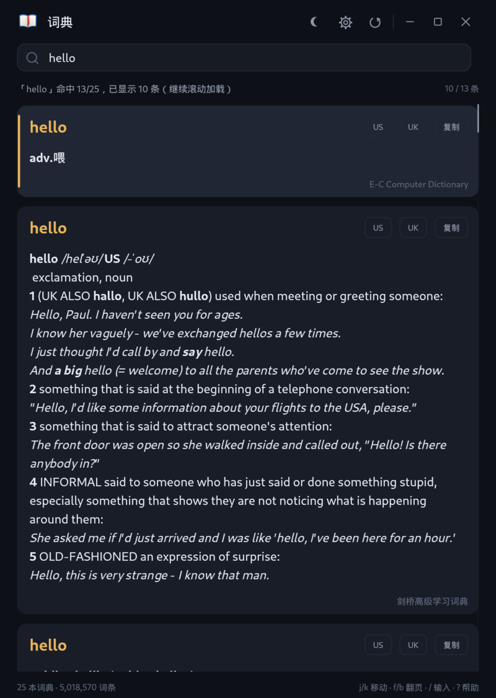
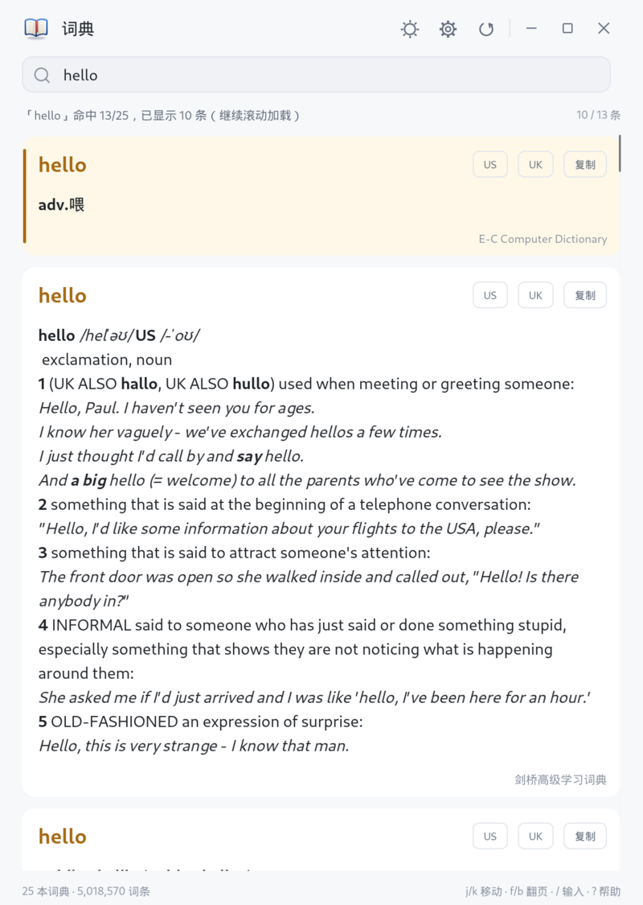
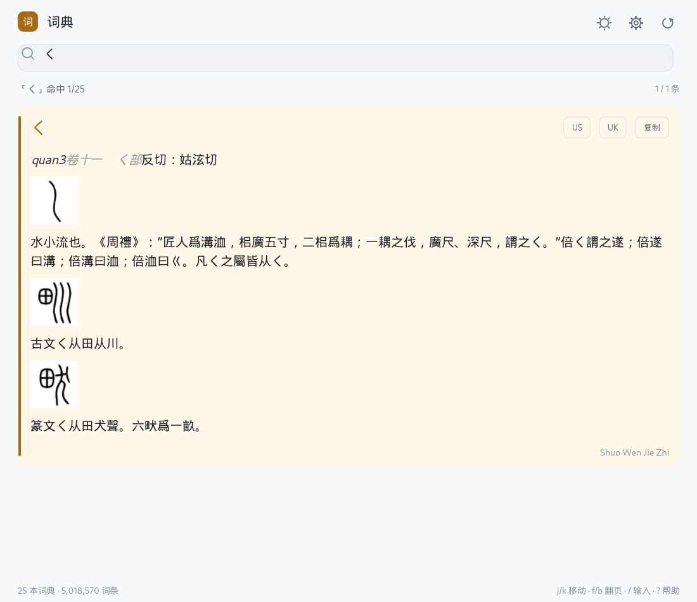

# lexicon-dict

**Linux（Fedora / Debian / Ubuntu）/ Windows 单二进制离线词典应用。** 直接读取 `.ld2`，转换为本地 StarDict 缓存后查询；
没有 daemon、没有 GNOME 扩展、没有浏览器内核、没有外部 UI 运行时。

- Linux：一个 `lexicon-dict` 可执行文件（约 7.9 MB）
- Debian/Ubuntu：`.deb` 安装包（约 2.7 MB）+ 同一基线的便携 tar.gz（amd64）
- Windows：一个 `lexicon-dict.exe`（约 6.3 MB）
- 查询/渲染/设置/发音全部在同一个进程内；词典用 mmap，冷启动约 0.3–0.6 s



## 功能

- 多词典同时查询，结果按匹配质量排序；单词、大小写、前缀回退
- 多词 Tab（空格分隔）、j/k 导航、f/b 翻页、g/G 首尾、y 复制、v/V 发音、`/` 输入、`?` 帮助
- 释义 Pango 富文本（粗体/斜体/下划线/颜色）、内嵌字形图（如说文解字）
- 词典启用/排序、扫描并转换、源目录、查询选项、字号、深/浅主题、快捷键自定义
- 在设置中添加词典源目录后，一键扫描并转换，状态栏显示进度
- 便携模式：可执行文件同级 `portable` 标记 → 配置与缓存写入同级 `data/`



## 使用

### Fedora

```bash
# 方式一：tar.gz
tar xf lexicon-dict-0.1.0-linux-x86_64.tar.gz
cd lexicon-dict-0.1.0-linux-x86_64
./install.sh                 # 安装到 ~/.local，生成应用菜单项

# 方式二：RPM
sudo dnf install ./lexicon-dict-0.1.0-1.fc44.x86_64.rpm
```

启动「词典」，在「设置 → 词典目录」中点击“添加”，选择 `.ld2` 所在目录，
再点“扫描并转换”。默认不预设任何词典目录。

### Debian / Ubuntu

Debian 12+ / Ubuntu 22.04+（amd64）可直接安装预编译包：

```bash
sudo apt install ./lexicon-dict_0.1.0_amd64.deb
```

或使用免安装版：

```bash
tar xf lexicon-dict-0.1.0-ubuntu22.04-amd64.tar.gz
cd lexicon-dict-0.1.0-ubuntu22.04-amd64
./install.sh
```

二进制在 Ubuntu 22.04（glibc 2.35）容器内构建，因此兼容 Ubuntu 22.04/24.04
与 Debian 12/13；更老的发行版请用源码在本机构建。运行时需要
X11/Wayland、OpenGL、xkbcommon、fontconfig 等桌面基础库，`.deb` 已声明依赖。

### Windows 11

解压 `lexicon-dict-0.1.0-windows-x86_64.zip`，双击 `lexicon-dict.exe`；
在「设置 → 词典目录」中添加 `.ld2` 所在目录后点“扫描并转换”。
zip 内含 `portable` 标记；删除后使用 `%APPDATA%\lexicon-dict`（配置）
与 `%LOCALAPPDATA%\lexicon-dict\stardict`（缓存）。

### 快捷键

| 键 | 动作 |
|---|---|
| `j` / `k` | 下一条 / 上一条 |
| `f` / `b` | 向下 / 向上翻页 |
| `g` / `G` | 第一条 / 最后一条 |
| `Tab` / `Shift+Tab` | 下一个 / 上一个查询词 |
| `y` | 复制当前释义 |
| `v` / `V` | 美音 / 英音 |
| `/` | 回到输入框 |
| `?` | 快捷键帮助 |
| `Esc` | 返回输入框 / 关闭帮助 |

全部可在「设置 → 快捷键」中修改或留空禁用。

## 构建

打包脚本会自动通过 `scripts/rustc-remap.sh` 重映射源码/工具链绝对路径，
生成的二进制和安装包不会包含构建机的用户目录。手动构建时也可显式设置
`RUSTC_WRAPPER=scripts/rustc-remap.sh`。

```bash
# Linux（Rust 1.90+，Wayland/X11 开发库由系统提供）
cargo build --release -p lexicon-app

# Windows 交叉编译（mingw 工具链）
cargo build --release --target x86_64-pc-windows-gnu -p lexicon-app

# 打包：Linux tar.gz + RPM + Windows zip + SHA256SUMS
make dist

# 打包 Debian/Ubuntu：在 Ubuntu 22.04 容器内构建 + 生成 .deb/tar.gz
make ubuntu
```

## 发布

推送到 `deploy` 分支会触发 `.github/workflows/release.yml`：

- 在 Ubuntu 22.04 上生成 Linux tar.gz、Fedora RPM、Ubuntu/Debian `.deb`、Windows zip；
- 自动计算 `SHA256SUMS`；
- 以 `v<版本>` 创建/更新 GitHub Release 并附带全部产物。

默认开发分支为 `main`，`deploy` 只用于发布。

## 数据位置

| 平台 | 配置 | 缓存 |
|---|---|---|
| Linux | `~/.config/lexicon-dict/` | `~/.cache/lexicon-dict/stardict/` |
| Windows 便携 | `<exe>\data\` | `<exe>\data\stardict\` |
| Windows 安装 | `%APPDATA%\lexicon-dict\` | `%LOCALAPPDATA%\lexicon-dict\stardict\` |

词典源目录不设默认值；首次使用请在设置中添加。缓存的 StarDict 目录可直接复用已有转换结果。

## 性能与验证

- Fedora 44 / 25 本词典 / 5,018,570 词条：冷启动到截图完成 0.66 s；
  查询与渲染在进程内完成。
- 核心转换与 Python 原实现逐字节一致；markup 抽样 21 本 100%；查询 106 词 0 失败。
- Windows 单文件在 Wine 下验证：启动、查询、中文/CJK 字体、添加源目录后转换、截图。
- 键盘焦点：查询后焦点移到结果区（`/` 回输入框），j/k 不会再输入到搜索框。



## 已知限制

- 没有全局热键与托盘（Linux Wayland 需 portal；Windows 可后续加 RegisterHotKey）。
- 源目录目前是文本输入（未接系统文件选择器，保持零 UI 依赖）。
- UI 使用 egui 自绘，不是 GTK/Win32 原生控件；换取了单二进制与跨平台一致体验。
- 真机 Windows 11 上的中文 IME、高 DPI、多显示器仍需验收。
- Debian/Ubuntu 包仅提供 amd64；ARM64 需在对应机器上源码构建。
- Wine 默认不带 SAPI 语音包，`v/V` 发音无声；真机 Windows 使用系统语音即可。查询、复制不受影响。

## 目录

```
crates/
  lexicon-core/     # .ld2 解析、StarDict 转换/读取、查询、markup
  lexicon-app/      # 单二进制桌面 app（eframe/egui）
  lexicon-cli/      # 转换/诊断 CLI（可选）
packaging/        # Linux tar.gz/RPM、Debian/Ubuntu .deb、Windows zip、Inno Setup
.github/          # GitHub Actions 发布流水线
docs/             # 架构、Windows 说明
scripts/          # 构建辅助（路径重映射）
```

## License

MIT
